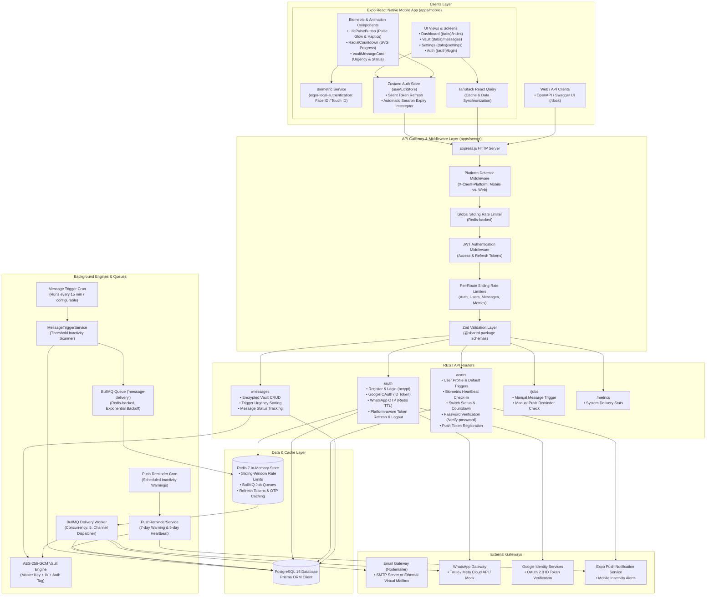
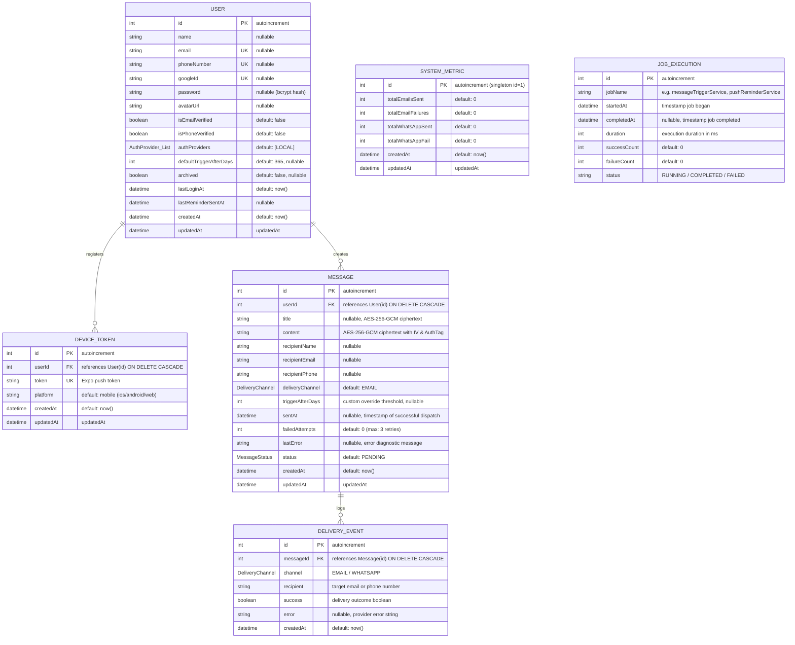
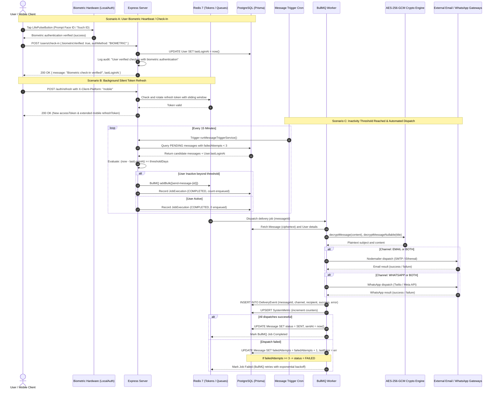
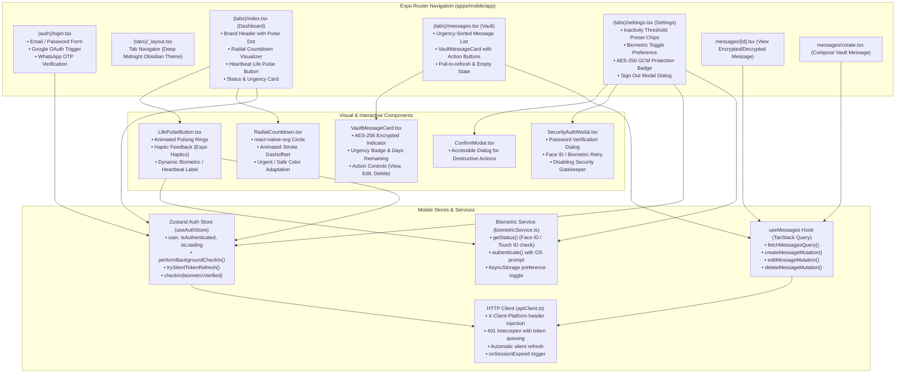
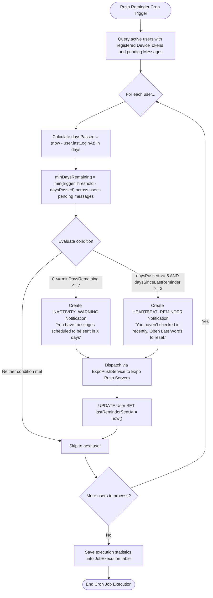
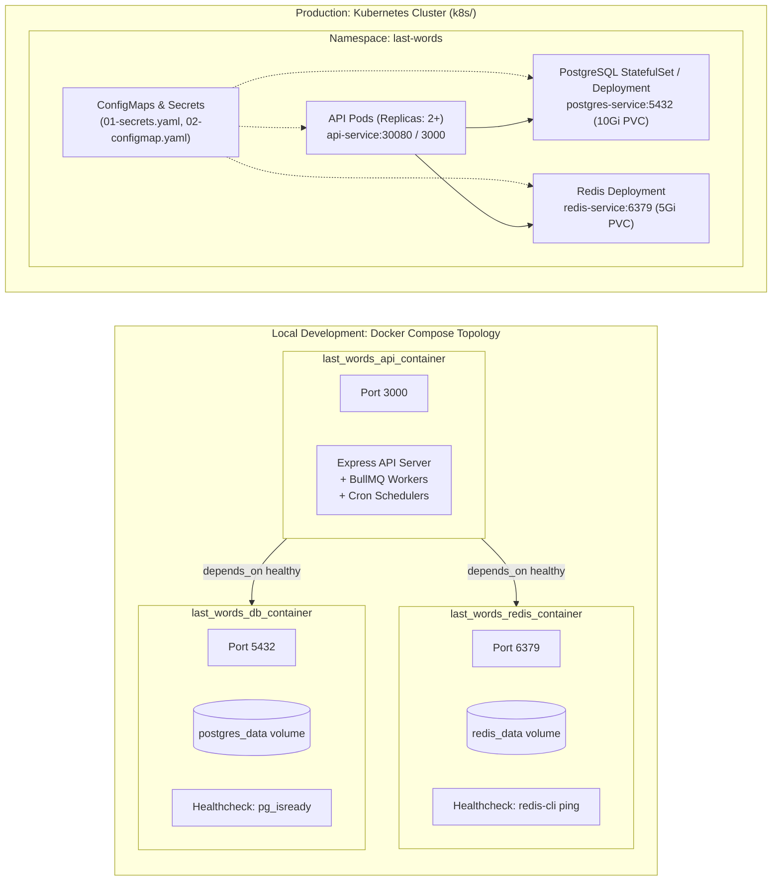

# Last Words — System Architecture & ER Diagrams

This document provides a comprehensive technical overview of the **Last Words** platform, including its system topology, database Entity-Relationship (ER) model, Dead Man's Switch execution workflows, Biometric heartbeat check-in mechanics, and mobile client state architecture.

---

## 1. System Architecture Diagram

---

## 2. Database Entity-Relationship (ER) Diagram

The diagram below reflects the PostgreSQL schema managed via Prisma ORM (`apps/server/prisma/schema.prisma`).

### Enums & Audit Actions

| Enum Name | Values | Context / Purpose |
| :--- | :--- | :--- |
| **`AuthProvider`** | `LOCAL`, `GOOGLE`, `WHATSAPP` | Allowed authentication mechanisms linked to user identity. |
| **`DeliveryChannel`** | `EMAIL`, `WHATSAPP`, `BOTH` | Destination delivery channels configured for scheduled message dispatches. |
| **`MessageStatus`** | `PENDING`, `SENT`, `FAILED` | Vault message lifecycle status. Marked `FAILED` when `failedAttempts >= 3`. |
| **`AuditLogActions`** | `LOGIN`, `MESSAGE_CREATED`, `MESSAGE_TRIGGERED` | User actions logged for system audit trails. |

---

## 3. Dead Man's Switch, Biometric Pulse & Delivery Flow

---

## 4. Mobile Application Component & State Architecture

---

## 5. Push Notification Inactivity Warning Workflow

---

## 6. Container & Deployment Infrastructure

